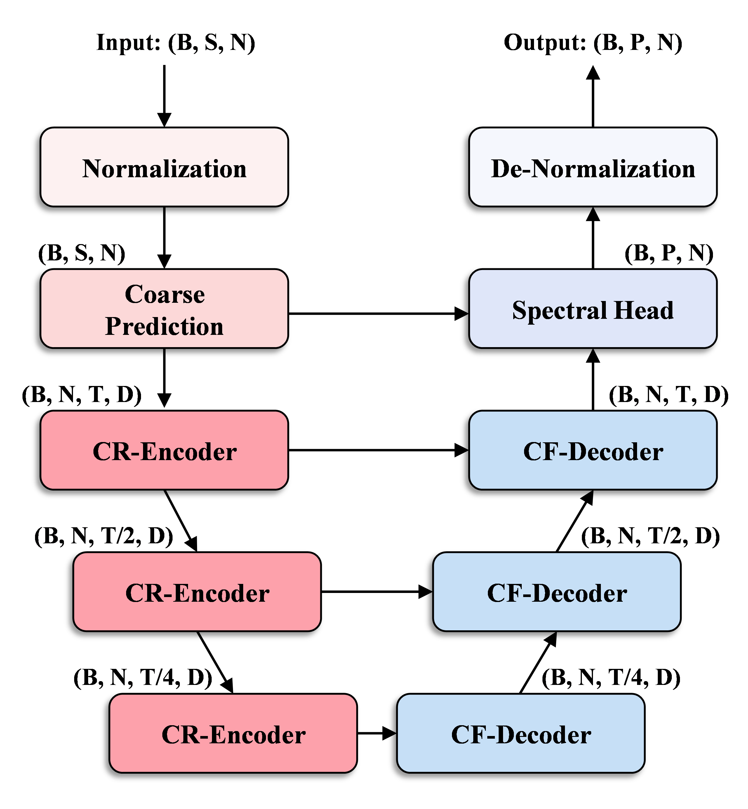
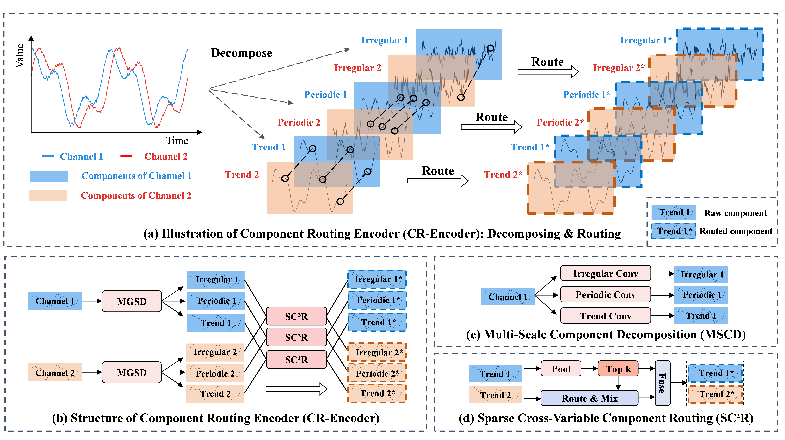

# DAU-Net

Official implementation of **DAU-Net: A Scale-Adaptive U-Net for Multivariate Time Series Forecasting**.

DAU-Net is a U-Net-style forecasting model designed for multivariate time series. It addresses two structural issues in existing multi-scale forecasting methods: input-side multi-scale patching does not explicitly establish stable resolution levels, and cross-variable dependencies are often treated as invariant across temporal resolutions. DAU-Net constructs an explicit resolution pyramid with progressive downsampling and learns sparse, scale-specific cross-variable routing.

The implementation includes the main model, benchmark data loaders, training/evaluation code, and the components used in the paper:

- **MSCD** (Multi-Scale Component Decomposition) separates heterogeneous temporal dynamics.
- **SC$^2$R** (Sparse Cross-Variable Component Routing) learns component- and resolution-specific variable interactions.
- **CGF** (Conditional Gated Fusion) reconstructs information through gated U-Net skip connections.
- **SEH** (Spectral Enhancement Head) refines residual frequency-domain distortions.

This is research code. It is intended for reproducible experiments and model extension rather than production deployment.

## Model architecture

The overall DAU-Net architecture follows a U-Net-style coarse-to-fine forecasting pathway. Progressive downsampling builds the resolution pyramid, while skip connections and gated fusion restore fine-grained temporal information.

<p align="center">
  
</p>
<p align="center"><em>Overall architecture of DAU-Net.</em></p>

The Component Routing Encoder decomposes temporal dynamics with MSCD and learns sparse, resolution-specific cross-variable interactions with SC$^2$R.

<p align="center">
  
</p>
<p align="center"><em>Detailed architecture of the Component Routing Encoder.</em></p>

## Repository structure

```text
.
|-- data_provider/          # Dataset classes and data factory
|-- exp/                    # Training, validation, and test loops
|-- layers/                 # Embedding and normalization layers
|-- models/                 # DAU-Net implementation
|-- figures/                # Model-structure figures used in this README
|-- utils/                  # Metrics, time features, and training utilities
|-- run.py                  # Main command-line entry point
|-- requirements.txt        # Python dependencies
|-- LICENSE                 # MIT license
|-- NOTICE.md               # Dataset and third-party notices
`-- RELEASE_CHECKLIST.md    # Public-release checklist
```

## Installation

Python 3.9--3.12 is recommended. Create an isolated environment and install the dependencies:

### Windows PowerShell

```powershell
python -m venv .venv
.\.venv\Scripts\Activate.ps1
python -m pip install --upgrade pip
python -m pip install -r requirements.txt
```

### Linux or macOS

```bash
python -m venv .venv
source .venv/bin/activate
python -m pip install --upgrade pip
python -m pip install -r requirements.txt
```

The code automatically uses CUDA when it is available and `--use_gpu True` is specified. Use `--use_gpu False` for CPU execution.

## Dataset preparation

Dataset files are intentionally not included in this repository. Download them from their original public sources and place them under `./dataset/` using the layouts below.

| Dataset option | Expected path | Expected format |
|---|---|---|
| `ETTh1`, `ETTh2` | `dataset/ETT-small/ETTh1.csv` or `ETTh2.csv` | CSV with a `date` column followed by numeric variables |
| `ETTm1`, `ETTm2` | `dataset/ETT-small/ETTm1.csv` or `ETTm2.csv` | CSV with a `date` column followed by numeric variables |
| `custom` | User-specified `--root_path` and `--data_path` | CSV with a `date` column and numeric variables |
| `illness` | User-specified `--root_path` and `--data_path` | CSV in the same format as the custom loader |
| `PEMS03`--`PEMS08` | User-specified `--root_path` and `--data_path` | `.npz`; the first array has shape `[time, node, channel]` and channel 0 is used |
| `solar` | User-specified `--root_path` and `--data_path` | CSV/TXT with a timestamp column followed by plant readings |

The loaders use the following default splits:

- ETT hourly/minute datasets: the standard chronological ETT split implemented in `data_provider/data_loader.py`.
- Custom and solar datasets: 70% training, 10% validation, and 20% test.
- PEMS datasets: 60% training, 20% validation, and 20% test.

For multivariate forecasting, `--enc_in`, `--dec_in`, and `--c_out` must match the number of input/output variables. For the default MSCD setting, `--d_model` must be divisible by `--mscd_K`.

## Quick start

The following command trains and evaluates DAU-Net on ETTh1 with a 96-step input and a 96-step prediction horizon:

```bash
python -u run.py \
  --task_name long_term_forecast \
  --is_training 1 \
  --model_id ETTh1_96_96 \
  --model DAU-Net \
  --data ETTh1 \
  --root_path ./dataset/ETT-small/ \
  --data_path ETTh1.csv \
  --features M \
  --seq_len 96 \
  --label_len 48 \
  --pred_len 96 \
  --enc_in 7 \
  --dec_in 7 \
  --c_out 7 \
  --d_model 66 \
  --d_ff 64 \
  --e_layers 2 \
  --mscd_K 3 \
  --num_workers 0 \
  --itr 1 \
  --use_gpu False
```

The same command can be run in PowerShell after replacing the line-continuation character `\` with the PowerShell backtick, or by placing the arguments on one line:

```powershell
python -u run.py --task_name long_term_forecast --is_training 1 --model_id ETTh1_96_96 --model DAU-Net --data ETTh1 --root_path .\dataset\ETT-small\ --data_path ETTh1.csv --features M --seq_len 96 --label_len 48 --pred_len 96 --enc_in 7 --dec_in 7 --c_out 7 --d_model 66 --d_ff 64 --e_layers 2 --mscd_K 3 --num_workers 0 --itr 1 --use_gpu False
```

To evaluate a saved checkpoint, use the same model and data arguments with `--is_training 0` and point `--checkpoints` to the directory containing the generated setting folder:

```bash
python -u run.py \
  --is_training 0 \
  --model_id ETTh1_96_96 \
  --model DAU-Net \
  --data ETTh1 \
  --root_path ./dataset/ETT-small/ \
  --data_path ETTh1.csv \
  --features M \
  --seq_len 96 --label_len 48 --pred_len 96 \
  --enc_in 7 --dec_in 7 --c_out 7 \
  --d_model 66 --d_ff 64 --e_layers 2 --mscd_K 3 \
  --checkpoints ./checkpoints \
  --num_workers 0 \
  --use_gpu False
```

`SC-Net` and `SCUNet` remain accepted as legacy values for `--model`, so existing experiment commands and checkpoints remain usable. New experiments should use `--model DAU-Net`.

## Outputs

Training checkpoints are written to `./checkpoints/`. Evaluation outputs are written to `./outputs/` by default and can be changed with `--output_path`. The output directory contains:

```text
outputs/
|-- results/<setting>/
|   |-- metrics.npy
|   |-- pred.npy
|   `-- true.npy
`-- test_results/<setting>/
```

The final MSE and MAE are also appended to `result_long_term_forecast.txt`. These generated files are ignored by Git.

## Main options

| Option | Default | Description |
|---|---:|---|
| `--seq_len` | 96 | Historical input length |
| `--pred_len` | 96 | Forecasting horizon |
| `--d_model` | 66 | Hidden feature dimension |
| `--e_layers` | 2 | Number of encoder downsampling levels |
| `--mscd_K` | 3 | Number of temporal component branches |
| `--sc2r_M_avg` | 2 | Average routed edges per variable |
| `--sc2r_K_edges` | None | Optional absolute edge-count override |
| `--dropout` | 0.25 | Dropout probability |
| `--train_epochs` | 10 | Maximum training epochs |
| `--batch_size` | 32 | Training batch size |
| `--learning_rate` | 0.0015 | Adam learning rate |
| `--seed` | 2021 | Random seed |
| `--use_gpu` | True | Use CUDA when available |
| `--output_path` | `./outputs` | Directory for predictions and metrics |

## Reproducibility notes

The default seed is 2021. Results can vary with GPU type, PyTorch version, number of workers, and data-loader behavior. For a strict comparison, keep the dataset split, preprocessing, hyperparameters, seed, and software versions fixed. The benchmark loaders and model configuration used by this release are contained in the repository so that the experiment setup can be inspected directly.

## License and citation

The source code is released under the MIT License. Dataset files are not covered by this repository's license; users must follow the terms of the original dataset providers.

If you use this code, please cite:

```bibtex
@article{daunet2026,
  title   = {DAU-Net: A Scale-Adaptive U-Net for Multivariate Time Series Forecasting},
  journal = {Information Sciences},
  year    = {2026}
}
```

Before publishing the repository, replace or extend the citation metadata with the final author list, DOI, and publication information when available.

## Contact

Please use the repository issue tracker for bug reports, reproducibility questions, and suggestions for improvements.
